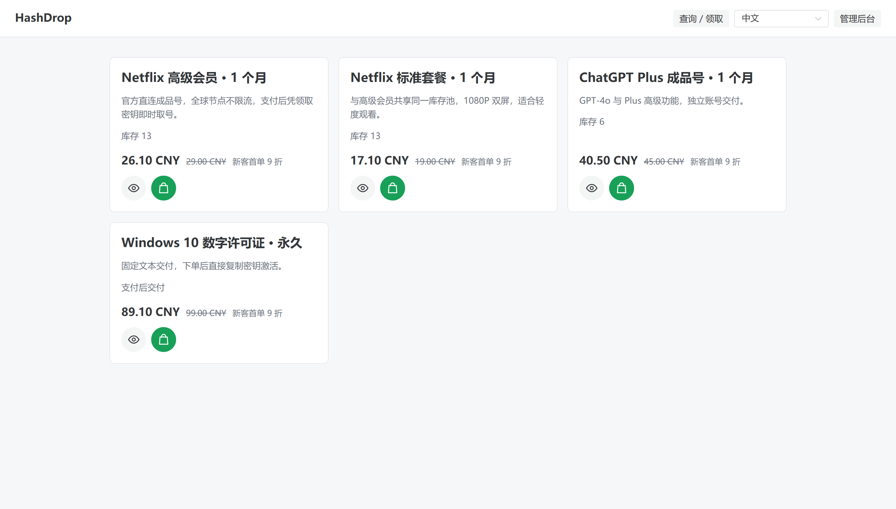
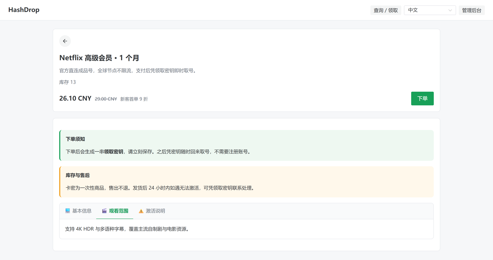
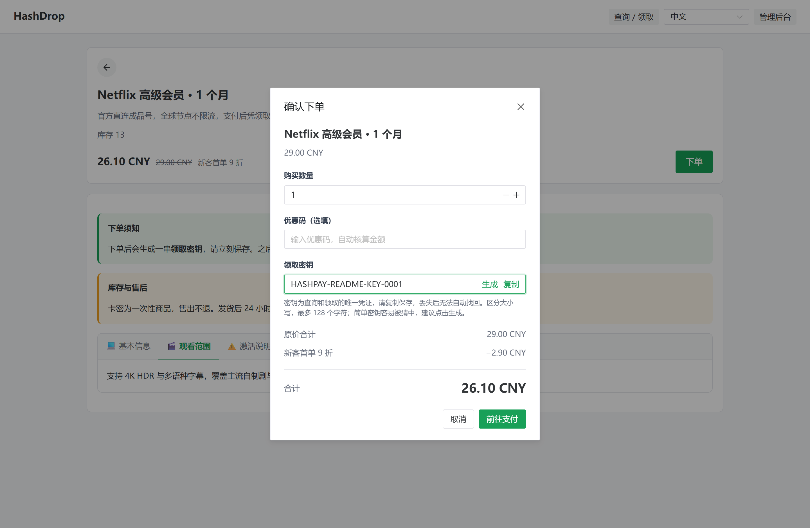

<div align="center">
  
  <h1>HashDrop</h1>
  <p>对接 HashPay 的匿名数字商品交付系统</p>
</div>

<p align="center">
  
  
  
</p>

<p align="center">
  <a href="https://github.com/sunnyhmz7010/HashDrop/releases"></a>
  <a href="https://github.com/sunnyhmz7010/HashDrop/blob/main/LICENSE"></a>
</p>

---

## ✨ 为什么做这个项目

HashPay 提供了加密货币收款能力。HashDrop 在此基础上补齐商品展示、库存管理、订单查询与自动交付，方便个人或小团队在 VPS 上搭建数字商品商城。

- 直接接入 HashPay，将收款与支付状态核验交给支付网关
- 为买家提供无需注册账号的下单、支付和凭密钥领取流程
- 通过 Go 单体服务与 SQLite 简化部署和维护，适合在 VPS 上独立运行

## 📸 截图预览







## 🚀 核心能力

- 匿名购买：买家无需注册账号，凭领取密钥查询订单、继续支付和领取商品
- 支付交付：对接 HashPay 收款，核验付款后自动交付，支持异常重试与人工补交
- 内容编排：自由组合文字、链接与库存取货项，可设置购买数量范围和公开交付说明
- 库存分配：支持卡密批量导入、一次性消耗或重复发放，以及多库存池备选与分配优先级
- 优惠管理：支持自动优惠活动和优惠码，可配置折扣、适用范围、门槛与使用限制
- 商家后台：通过网页初始化，使用单管理员账号管理商品、库存、订单及站点配置
- 赞赏页面：通过 HashPay 接收多币种赞赏，支持昵称历史查询与自愿公开的赞赏名单
- 站点与数据：提供中英文界面和移动端适配，使用 SQLite 保存数据并定时备份、校验

## ⚡ 快速开始

### 📋 前置要求

- 一台安装了 Docker Engine 的 Linux VPS（使用 Compose 部署时，还需 Docker Compose V2）
- 支付网关：[HashPay](https://github.com/tgdash/HashPay)（可在初始化后配置，正式收款前需要接入）

### 📦 安装与运行

#### 🐳 Docker 部署

```bash
docker run -d \
  --name hashdrop \
  --restart unless-stopped \
  -p 8080:8080 \
  -v hashdrop_data:/data \
  ghcr.io/sunnyhmz7010/hashdrop:2.0.0
```

也可以使用 Docker Compose：根目录已提供 `compose.yaml`，执行以下命令即可启动：

```bash
docker compose up -d
```

## 📖 使用说明

### 🔧 首次初始化

1. 服务启动后，访问商城的 `/setup` 页面。在服务器本机可打开 `http://localhost:8080/setup`；远程生产环境请先配置 HTTPS 域名，例如 `https://shop.example.com/setup`。
2. 填写站点名称、站点地址以及管理员账号和密码。站点地址应与实际访问地址一致。
3. 配置 HashPay 网关地址（HTTPS）、商户 ID 与 RSA 私钥。三项可以全部留空，稍后在后台的「系统设置」中补充。
4. 初始化完成后会自动登录并进入 `/center`，创建库存池、上架商品，即可开始使用。若当前访问地址与配置的站点地址不同，则自动前往配置站点的登录页。

使用 HTTPS 站点时，后台会显示 HashPay 回调地址 `https://你的商城域名/api/webhooks/hashpay`，将其中的域名替换为实际商城域名；HTTP 站点仅通过签名查询补查付款，不接受支付回调。不要通过公网明文 HTTP 提交管理员密码或商户私钥。

### 👤 买家购买与领取

1. 在商城选择商品，阅读交付说明，在允许的数量范围内确认金额。
2. 设置并妥善保存领取密钥，然后前往 HashPay 支付。
3. 支付完成后进入「个人中心」查看订单，点击「领取内容」打开已完成的交付。文字与链接按商家编排展示；多份订单已完成的部分可以先领取。其他设备可凭领取密钥导入订单。

领取密钥是查询和领取订单的凭证，丢失后无法找回，建议使用页面自动生成的密钥。

当前浏览器长期保存已下单或导入的订单信息与领取密钥，不保存交付内容。可在个人中心主动清除本地历史；清除前请备份密钥，清除浏览器数据后也需要凭密钥重新导入。订单历史不会自动同步到其他设备。

### 🛠️ 商家管理

进入 `/center`，点击「管理员登录」。登录后，个人菜单会显示管理入口：

1. 商品：设置价格、购买数量与交付说明，编排文字、链接，以及每份商品需要的库存取货项。每个取货项有独立名称与所需数量；固定内容无需库存池。交付说明在购买前公开，不能包含卡密、密码等秘密。
2. 库存：创建库存池，设置是否重复发放，并绑定商品的具体取货项。可按行批量导入卡密，也可使用内容编辑器添加组合库存。缺少必需资源的商品无法下单。
3. 优惠：按需要设置自动活动或优惠码。
4. 订单：按订单号、商品名及付款、交付状态筛选。已核验付款的异常订单可以重试原分配，或用同一内容编辑器补交未完成部分；补交归还原来未使用的独占库存，成功结果不可覆盖。
5. 系统设置：维护站点信息及 HashPay 配置；还可按需开启赞赏页。

商城入口为 `/`，个人中心与管理入口统一为 `/center`。个人订单与赞赏记录始终可见，管理员登录后追加管理菜单。

### 💝 赞赏与记录

启用后，访客可在 `/donate` 选择币种与金额、填写昵称，并决定是否展示在公开名单中。同昵称再次赞赏需要确认，也可更换昵称。

在个人中心可凭昵称找回该昵称的全部赞赏，并导入或清除本地历史。昵称用于公开查询，知道昵称的人仍可查询金额和付款状态；选择不公开仅影响公开名单。

商家可在「赞赏页」为 CNY、USD、USDT 等币种分别配置预设金额与自定义金额范围，在概览中按昵称查看历史、核验付款，并按币种汇总到账金额。

### 🔒 HTTPS 与访问控制

- 生产环境建议通过 Nginx、1Panel OpenResty 等反向代理提供 HTTPS，并限制对 `8080` 后端端口的直接访问
- 如反向代理部署在同一台主机，可将 Compose 的端口映射由 `8080:8080` 改成 `127.0.0.1:8080:8080`；使用 `docker run` 时则改为 `-p 127.0.0.1:8080:8080`
- 请使用实际的 HTTPS 商城域名完成初始化与 HashPay 回调配置

### 💾 数据持久化与备份

- Docker 数据卷 `hashdrop_data` 挂载到 `/data`，保存 SQLite 数据库、站点配置、加密密钥、HashPay 私钥及备份文件；更新容器时务必保留该数据卷
- 服务运行期间约每 24 小时自动创建一次数据库备份，并执行完整性校验；备份位于 `/data/backups/`
- 如需手动备份数据库，指定一个尚不存在的文件：

```bash
docker exec hashdrop /app/hashdrop \
  -config /data/config.json \
  -backup "/data/backups/manual-$(date +%Y%m%d-%H%M%S).db"
```

恢复时除数据库备份外，还需要配套保留 `config.json`（包含加密密钥）和 HashPay 私钥文件。自动备份与原数据位于同一数据卷，应另外保存至其他存储位置，并自行管理历史备份数量。

当前源码使用数据库结构版本 8，仅支持全新安装，不提供旧版本数据库迁移。v2.0.0 的结构版本为 7，包含已移除的附件功能；部署当前源码时请使用新建的数据目录，并保留旧数据卷及其配套配置。

## 🧠 功能细节

### 🧾 匿名下单与领取

- 下单前校验商品、购买数量和可用库存，并计算优惠后的实际金额
- 买家自行设置领取密钥，无需注册账号；领取密钥不能重复用于不同订单
- 凭领取密钥查询订单，查看支付状态、继续支付或领取已交付的内容
- 支持一次购买多份商品，并分别记录每份商品的交付结果

### 💳 HashPay 支付与订单同步

- 通过 HashPay 商户 API 创建收款订单，买家前往 HashPay 收银台完成支付
- 接收加密支付回调，并定期补查未完成订单，避免仅依赖浏览器跳转判断支付结果
- 核对支付订单身份、金额和币种，确认付款后才触发自动交付
- 已核实的付款不会因后续网关状态回退而重新变成未付款或释放库存；手动刷新仍核验原网关身份与金额
- 支付订单终止时释放已预留的库存；异常订单可在后台重新核验或重试交付

### 📦 库存、资源与交付编排

- 商品描述卖什么，交付计划描述如何组合内容，库存池负责资源分配，订单记录实际交付结果
- 例如“说明文字 + 下载链接 + 激活码”：前两项可共享，激活码每购买一份从库存取一条；购买两份只消耗两条卡密
- 库存池绑定到具体取货项；同项多池按随机、先绑定或后绑定优先分配，共享池的可售量按全部取货需求共同计算
- 一次性库存按录入顺序使用，重复库存按持久化顺序循环；每份取货数量可独立设置
- 下单在一个事务中预留全部资源和优惠次数，并冻结组合内容。后续修改商品、库存或绑定不改变已有订单
- 每份购买内容一起完成交付；已付款后的执行只依赖本地快照，支付网关暂时不可用不会阻塞待执行交付
- 失败项可重试或人工补交，重试不重新抽取库存。已完成结果禁止覆盖，相同补交请求可安全重试
- 支持自动优惠和优惠码，可配置折扣方式、适用范围、门槛及使用限制

领取授权独立于内容编排和库存执行。当前使用领取密钥；OIDC 身份认证、阅后即焚等访问保护尚未实现。

### 🛠️ 后台与站点维护

- 首次启动通过网页初始化，后续使用单管理员账号管理商城
- 集中维护商品、库存、订单、优惠规则及 HashPay 配置
- 使用 SQLite 持久化数据，支持数据库备份与校验
- 可按需启用独立赞赏页面，通过 HashPay 收款；支持多币种金额、同昵称再次赞赏确认与历史归组，公开名单只展示主动选择公开且已核验付款的记录
- 赞赏创建采用固定请求标识，网络中断后的重试恢复同一笔记录，避免重复创建

## 🧱 技术栈

- Go：HTTP 服务、业务处理与支付状态同步
- SQLite、modernc.org/sqlite：数据库与纯 Go 驱动
- Vue 3、Vue Router：商城及管理界面与前端路由
- TypeScript：前端类型检查
- Naive UI：界面组件
- Vite：前端开发与构建
- Docker：多阶段镜像构建与容器运行

## 🗂️ 项目结构

```text
HashDrop/
├── backend/              # 路由、业务、安全、支付与内置调度
│   └── web/              # 前端构建产物，嵌入二进制
├── frontend/
│   ├── src/pages/        # 商城、商品、初始化、个人中心与赞赏页
│   ├── src/components/   # 商城、订单与后台公共组件
│   └── tests/            # 核心购买与管理流程浏览器验证
├── schema.sql            # SQLite 数据库初始化结构
├── .github/
│   ├── ISSUE_TEMPLATE/   # 中英双语缺陷反馈与功能建议模板
│   └── workflows/        # Docker 镜像构建与发布工作流
├── Dockerfile            # 前端和 Go 多阶段构建，运行镜像无 Node.js
├── compose.yaml          # VPS 直接拉取镜像部署
├── deploy/               # systemd 服务示例
├── images/               # README 界面截图
├── assets.go             # 嵌入数据库结构与前端构建产物
└── go.mod                # Go 模块与依赖
```

## 👨‍💻 本地开发

### 🧰 环境

- 开发平台：Linux、macOS 或 Windows
- Go：1.27.0 或更高版本
- Node.js：24 或更高版本，包含 npm

### ⚙️ 启动服务

```bash
git clone https://github.com/sunnyhmz7010/HashDrop.git
cd HashDrop
npm ci --prefix frontend
npm --prefix frontend run build
go run ./backend -listen 127.0.0.1:8080
```

启动后访问 `http://127.0.0.1:8080/setup` 完成初始化。

### 🐳 构建镜像

```bash
docker build -t hashdrop .
```

## 🔐 安全报告

如果发现安全问题，请不要公开披露细节。请优先参考仓库中的 [SECURITY.md](./SECURITY.md) 提交安全报告。

## 📄 许可证

本项目基于 [GPL-3.0](./LICENSE) 开源。

<div align="center">
  <sub>Built with ❤️ by Sunny</sub>
</div>
