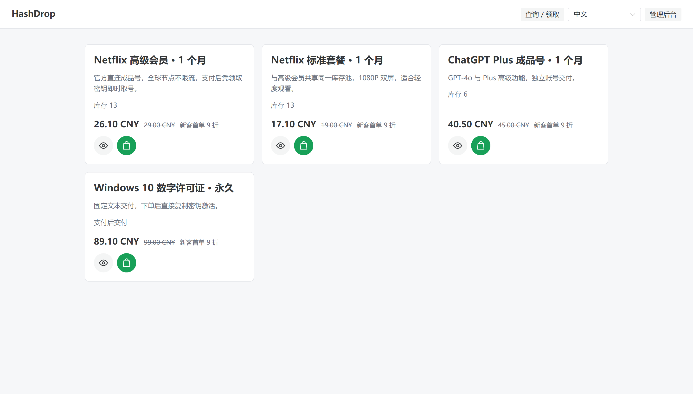
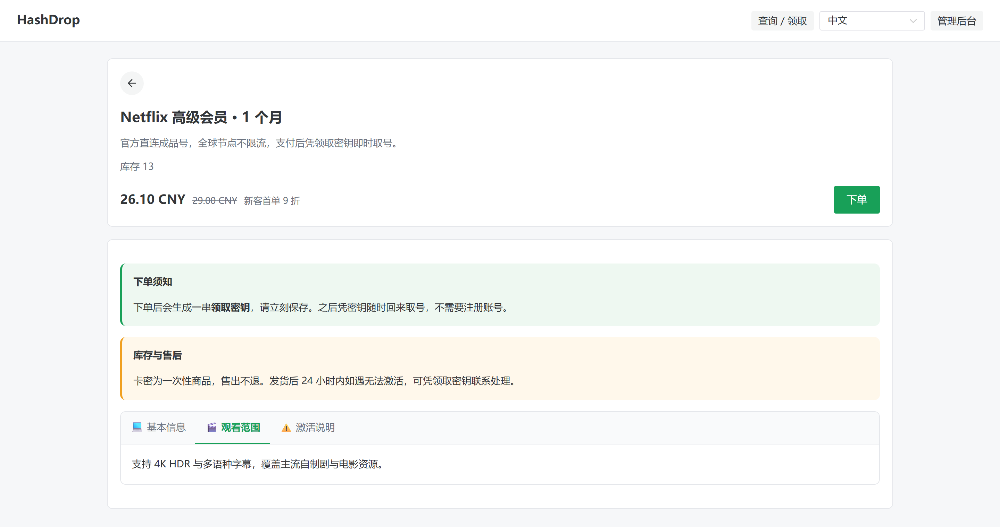
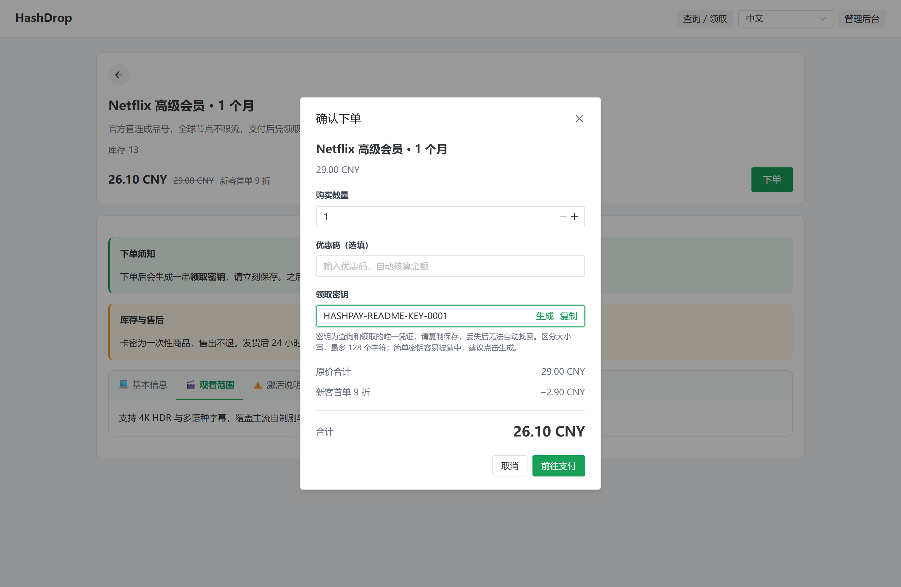

<div align="center">
  
  <h1>HashDrop</h1>
  <p>对接 HashPay 的匿名数字商品交付系统</p>
</div>

<p align="center">
  <a href="https://github.com/sunnyhmz7010/HashDrop/releases"></a>
  <a href="https://github.com/sunnyhmz7010/HashDrop/blob/main/LICENSE"></a>
</p>

---

## ✨ 为什么做这个项目

HashPay 已经提供了加密货币收款能力，但要真正销售数字商品，还需要商品展示、库存管理、订单查询和自动交付。HashDrop 的目标，就是对接 HashPay，提供一套轻量、易部署的数字商品商城解决方案，而不是重新开发支付系统。

- 直接接入 HashPay，将收款与支付状态核验交给支付网关
- 为买家提供无需注册账号的下单、支付和凭密钥领取流程
- 通过 Go 单体服务与 SQLite 简化部署和维护，适合在 VPS 上独立运行

## 📸 截图预览







## 🚀 核心能力

### 🛍️ 匿名商城

- 无需注册或登录，选择商品即可下单
- 对接 HashPay 收款，支付核验后自动交付
- 凭领取密钥查询订单、继续支付和领取商品
- 支持商品详情、隐藏商品链接、中英文界面和移动端访问

### 📦 商品与库存

- 支持卡密、账号和固定文本三种交付类型
- 商品可选择库存自动交付或人工交付；人工商品无需库存池即可上架
- 支持每单购买数量上下限、交付时效说明及可选或必填的买家信息
- 商品与库存池分开管理，多个商品可共享库存
- 支持自动优惠活动、优惠码和多种优惠规则
- 支持库存管理、订单查询和交付异常重试

### 🛠️ 站点管理

- 通过网页完成首次初始化，单管理员后台管理
- 管理商品、库存、订单、优惠及站点和支付配置
- 可启用独立赞赏页面，通过 HashPay 接收赞赏
- 使用 SQLite 保存数据，内置定时备份与完整性校验

## ⚡ 快速开始

### 📋 前置要求

- 一台安装了 Docker Engine 的 Linux VPS（使用 Compose 部署时，还需 Docker Compose V2）
- 支付网关：[HashPay](https://github.com/tgdash/HashPay)（可在初始化后配置，正式收款前需要接入）

### 📦 Docker Compose（推荐）

新建 `compose.yaml`，写入以下内容：

```yaml
services:
  hashdrop:
    image: ghcr.io/sunnyhmz7010/hashdrop:1.1.0
    container_name: hashdrop
    restart: unless-stopped
    ports:
      - "8080:8080"
    volumes:
      - hashdrop_data:/data

volumes:
  hashdrop_data:
```

然后启动：

```bash
docker compose up -d
```

查看日志：

```bash
docker compose logs -f
```

> 上面的 `8080:8080` 会将宿主机端口对外监听。生产环境建议先配置 HTTPS 反向代理，并将端口映射改为 `127.0.0.1:8080:8080`，避免直接向公网暴露管理与初始化页面。

### 🖥️ 命令行方式

```bash
docker run -d \
  --name hashdrop \
  --restart unless-stopped \
  -p 8080:8080 \
  -v hashdrop_data:/data \
  ghcr.io/sunnyhmz7010/hashdrop:1.1.0
```

### 🛠️ 自行构建镜像

如果你想自己构建而不是使用预构建镜像：

```bash
git clone https://github.com/sunnyhmz7010/HashDrop.git
cd HashDrop
docker build -t hashdrop .
docker run -d \
  --name hashdrop \
  --restart unless-stopped \
  -p 8080:8080 \
  -v hashdrop_data:/data \
  hashdrop
```

如果使用 Docker Compose，把 `compose.yaml` 里的 `image: ghcr.io/...` 换成 `build: .`，然后执行：`docker compose up -d --build`。

### 🔧 首次初始化

1. 服务启动后，访问商城的 `/setup` 页面。在服务器本机可打开 `http://localhost:8080/setup`；远程生产环境请先配置 HTTPS 域名，例如 `https://shop.example.com/setup`。
2. 填写站点名称、站点地址以及管理员账号和密码。站点地址应与实际访问地址一致。
3. 配置 HashPay 网关地址（HTTPS）、商户 ID 与 RSA 私钥。三项可以全部留空，稍后在后台的「系统设置」中补充。
4. 初始化完成后会自动登录并进入 `/center`，创建库存池、上架商品，即可开始使用。若当前访问地址与配置的站点地址不同，则自动前往配置站点的登录页。

使用 HTTPS 站点时，后台会显示 HashPay 回调地址 `https://你的商城域名/api/webhooks/hashpay`；HTTP 站点仅通过签名查询补查付款，不接受支付回调。**不要通过公网明文 HTTP 提交管理员密码或商户私钥。**

## 📖 使用说明

### 👤 买家购买与领取

1. 在商城选择商品，阅读交付说明，在允许的数量范围内确认金额；商品要求接收账号等信息时一并填写。
2. 设置并妥善保存领取密钥，然后前往 HashPay 支付。
3. 支付完成后进入「个人中心」查看订单历史和交付内容；人工交付商品会显示等待状态，商家可分份交付，已完成部分可立即领取。其他设备可凭领取密钥导入订单。

领取密钥是查询和领取订单的凭证，**丢失后无法找回**，建议使用页面自动生成的密钥。

当前浏览器长期保存已下单或导入的订单信息与领取密钥，不保存交付内容。可在个人中心主动清除本地历史；清除前请备份密钥，清除浏览器数据后也需要凭密钥重新导入。订单历史不会自动同步到其他设备。

买家信息在服务器中加密保存，仅持有订单领取密钥的买家及管理员可在订单详情查看，不写入浏览器长期订单历史；支付请求中断时，当前标签页会暂存原下单信息以恢复同一笔请求。

### 🛠️ 商家管理

进入 `/center`，点击「管理员登录」并在弹窗登录后，在个人菜单下追加管理菜单：

1. **库存**：创建库存池，选择卡密、账号或固定文本，并添加交付内容。
2. **商品**：创建商品，选择自动或人工交付；自动交付关联库存池。设置价格、每单数量限制、交付说明及需要买家填写的信息后上架。交付说明在购买前公开，不能包含卡密、密码等秘密。
3. **优惠**：按需要设置自动活动或优惠码。
4. **订单**：按订单号、网关订单号、商品名及付款、交付状态筛选订单。已核验付款的订单可重试自动交付，或在详情中点击「交付此份商品」输入卡密、账号、下载链接或服务处理结果。
5. **系统设置**：维护站点信息及 HashPay 配置；还可按需开启赞赏页。

商城入口为 `/`，个人中心与管理入口统一为 `/center`，赞赏页（启用后）为 `/donate`。个人订单与捐赠记录始终可见，管理员登录后追加管理菜单。赞赏时自行填写昵称，并选择是否展示在公开名单；昵称不能重复，冲突时会提供派生昵称建议。捐赠记录与商品订单分开保存，可凭昵称查询并导入本地历史，也可独立清除本地记录。

昵称用于公开查询，不是私密密码：不展示在名单中仅影响公开列表，知道昵称的人仍可查询金额和付款状态。新增赞赏不再发放查询链接；升级前的记录继续保留原凭证访问能力，不会自动公开。后台「赞赏页」按币种添加金额，无需输入逗号分隔文本，可同时配置 CNY、USD、USDT 等币种，每个币种分别设置预设金额与自定义金额范围。

### 🔒 HTTPS 与访问控制

- 生产环境建议通过 Nginx、1Panel OpenResty 等反向代理提供 HTTPS，并限制对 `8080` 后端端口的直接访问
- 如反向代理部署在同一台主机，可将 Compose 的端口映射由 `8080:8080` 改成 `127.0.0.1:8080:8080`；使用 `docker run` 时则改为 `-p 127.0.0.1:8080:8080`
- 请使用实际的 HTTPS 商城域名完成初始化与 HashPay 回调配置

### 💾 数据持久化与备份

- Docker 数据卷 `hashdrop_data` 挂载到 `/data`，保存 SQLite 数据库、站点配置、加密密钥、HashPay 私钥及备份文件；更新容器时务必保留该数据卷
- 服务运行期间约每 24 小时自动创建一次数据库备份，并执行完整性校验；备份位于 `/data/backups/`
- 如需手动备份数据库，可执行：

```bash
docker exec hashdrop /app/hashdrop \
  -config /data/config.json \
  -backup "/data/backups/manual-$(date +%Y%m%d-%H%M%S).db"
```

恢复时不能只保存数据库文件，还需要配套保留 `config.json` 和 HashPay 私钥文件。自动备份与原数据位于同一数据卷，建议另行将重要文件加密备份至其他存储位置，并自行管理历史备份数量。

已有结构版本 1 或 2 的数据库启动时会升级到版本 3；修改商品表前，会在数据库旁生成 `数据库文件名.pre-v3-随机标识.db` 快照，迁移在事务中完成并校验外键。升级前仍应保存完整数据卷。旧商品默认保持自动交付、每单 1–100 份；已创建订单的库存、优惠、领取密钥和交付内容保留。回退旧程序时必须恢复升级前的数据库快照及配套配置，旧程序不能直接读取新结构。

## 🧠 功能细节

### 🧾 匿名下单与领取

- 下单前校验商品、购买数量和可用库存，并计算优惠后的实际金额
- 买家自行设置领取密钥，无需注册账号；领取密钥不能重复用于不同订单
- 凭领取密钥查询订单，查看支付状态、继续支付或领取已交付的内容
- 支持一次购买多份商品，并分别记录每份商品的交付结果

### 💳 HashPay 支付与订单同步

- 通过 HashPay 商户 API 创建收款订单，买家前往 HashPay 收银台完成支付
- 接收加密支付回调，并定期补查未完成订单，避免仅依赖浏览器跳转判断支付结果
- 核对支付订单身份、金额和币种，确认付款后才触发自动交付
- 已核实的付款不会因后续网关状态回退而重新变成未付款或释放库存；手动刷新仍核验原网关身份与金额
- 支付订单终止时释放已预留的库存；异常订单可在后台重新核验或重试交付

### 📦 库存与优惠规则

- 卡密、账号使用库存池管理，固定文本可作为重复交付内容
- 库存池可关联多个商品，库存状态区分可用、预留和已售
- 批量导入库存时自动去重，库存内容加密保存
- 固定文本可包含重复使用的下载链接、使用说明等；人工交付可用于充值、定制服务和需要商家处理的订单
- 商品的交付说明和买家信息随订单保存快照；商品改名、修改说明、切换交付方式或下架不改变已有订单
- 人工交付按购买份数分别记录，每份提交后立即可领取；重复提交同一内容恢复原结果，已交付内容不能覆盖。补交自动订单时，会在同一事务中归还该份尚未使用的预留库存
- 支持自动优惠和优惠码，可配置折扣方式、适用范围、门槛及使用限制

### 🛠️ 后台与站点维护

- 首次启动通过网页初始化，后续使用单管理员账号管理商城
- 集中维护商品、库存、订单、优惠规则及 HashPay 配置
- 使用 SQLite 持久化数据，支持数据库备份与校验
- 可按需启用独立赞赏页面，通过 HashPay 收款；支持多币种金额、昵称查重与派生推荐，公开名单只展示主动选择公开且已核验付款的记录
- 赞赏创建采用固定请求标识，网络中断后的重试恢复同一笔记录，避免重复创建

## 🧱 技术栈

- 后端：Go、SQLite
- 前端：Vue 3、TypeScript
- 部署：Docker Compose，亦可使用 systemd 部署

## 🗂️ 项目结构

```text
HashDrop/
├── backend/              # 路由、业务、安全、支付与内置调度
│   └── web/              # 前端构建产物，嵌入二进制
├── frontend/
│   ├── src/pages/        # 商城、订单、登录与后台入口
│   ├── src/components/   # 管理页面组件
│   └── tests/            # 核心购买与管理流程浏览器验证
├── schema.sql            # SQLite 数据库初始化结构
├── .github/
│   ├── ISSUE_TEMPLATE/   # 中英双语缺陷反馈与功能建议模板
│   └── workflows/        # 推送 v* 标签时构建并发布 GHCR 多架构镜像
├── Dockerfile            # 前端和 Go 多阶段构建，运行镜像无 Node.js
├── compose.yaml          # VPS 直接拉取镜像部署
├── deploy/               # systemd 服务示例
├── images/               # README 界面截图
├── assets.go
└── go.mod
```

## 👨‍💻 本地开发

### 🧰 环境

- Go 1.27+
- Node.js 24+

### ⚙️ 命令

```sh
go test ./...
go vet ./...
npm ci --prefix frontend
npm --prefix frontend run check
npm --prefix frontend run build
cd frontend
npx playwright install chromium
npm run test:e2e
```

## 🔐 安全报告

如果发现安全问题，请不要公开披露细节。请优先参考仓库中的 [SECURITY.md](./SECURITY.md) 提交安全报告。

## 📄 许可证

本项目基于 [GPL-3.0](./LICENSE) 开源。

<div align="center">
  <sub>Built with ❤️ by Sunny</sub>
</div>
